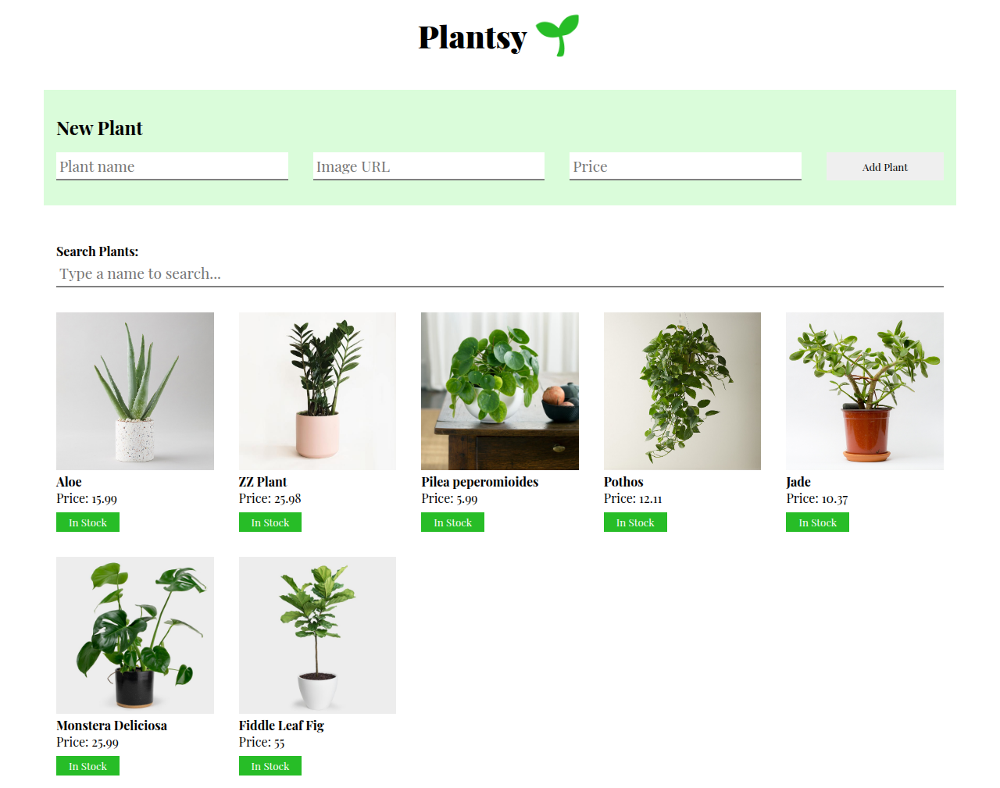

# Plantsy

Plantsy is a small plant shop admin app built with React. It loads plants from a local JSON Server API and lets you add plants, mark them in or out of stock, and search by name.

## Screenshot



## Features

- Fetch and display all plants when the app loads.
- Add a plant with its name, image URL, and price; the new plant is saved to the API.
- Toggle a plant between in stock and out of stock. Stock status is local to the current app session.
- Filter plants by name without regard to letter case. Clearing the search shows all plants again.

## Requirements

- Node.js and npm

## Getting Started

Install dependencies:

```sh
npm install
```

Start the API and frontend in separate terminals from the project directory:

```sh
npm run server
```

```sh
npm run dev
```

Open the local URL printed by Vite, usually [http://localhost:5173](http://localhost:5173). The API is available at [http://localhost:6001/plants](http://localhost:6001/plants).

## Tests

Run the test suite with:

```sh
npm test -- --run
```

## API

The app uses `http://localhost:6001/plants`:

- `GET /plants` loads the plant collection.
- `POST /plants` creates a plant with `name`, `image`, and `price` fields.

The JSON Server stores created plants in `db.json`.